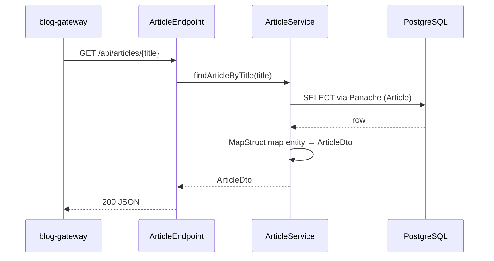

# 06 Runtime View

## 6.1 Startup (dev profile)

1. `make dev` → `./mvnw quarkus:dev`
2. Quarkus DevServices starts a `postgres:18` container and applies the init script
3. Liquibase applies migrations from `db/changeLog.xml` (`migrate-at-start=true`)
4. Hibernate validates the schema (`database.generation=validate`) — on mismatch, boot fails
5. The application listens on `:8080`; Swagger UI is always available

## 6.2 GET `/api/articles/{title}` — read an article

## 6.3 GET `/api/articles/search` — search with pagination

Gateway → endpoint → `searchArticleOverview(page, text, tags)` → DB query
(case-insensitive title/text match, AND logic across tags) → `ArticleOverview`
(list of previews + pagination meta) → 200 JSON.

## 6.4 DELETE `/api/articles/{title}` — delete by exact title

Gateway → endpoint → `deleteArticleByTitle(title)` → transactional delete
(case-insensitive) → response with the number of deleted rows.

## 6.5 POST / PUT

Stubs only — no runtime scenario yet (hardcoded responses).
